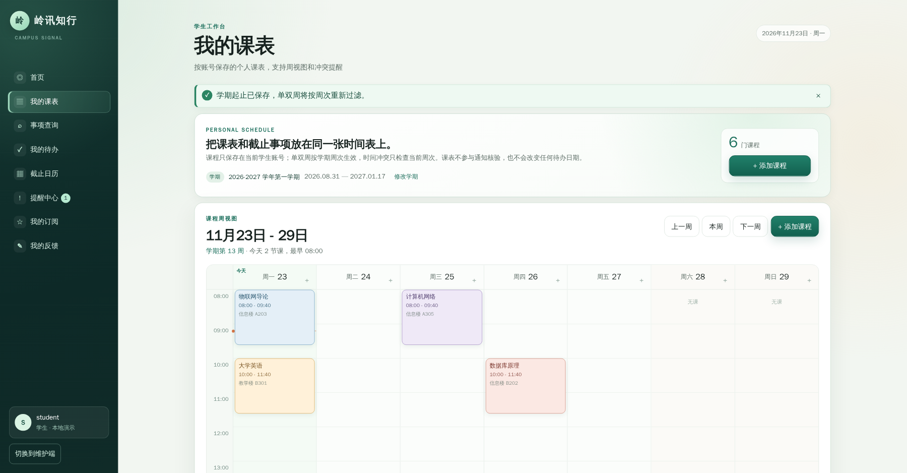
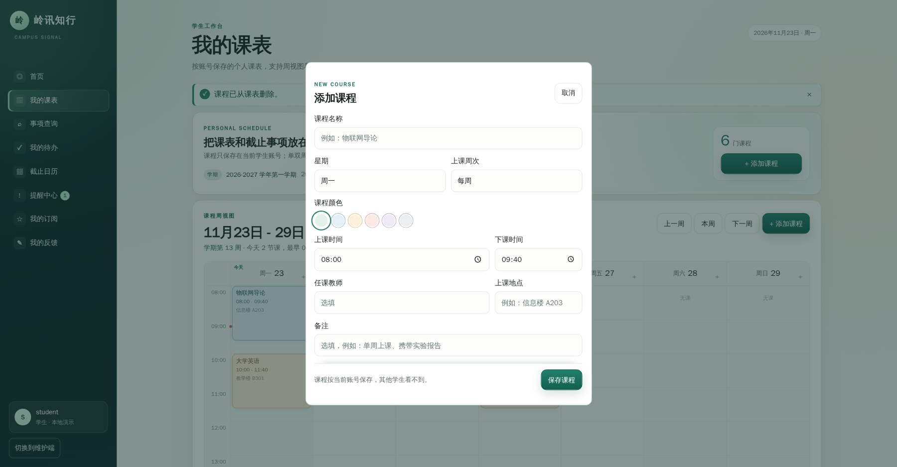
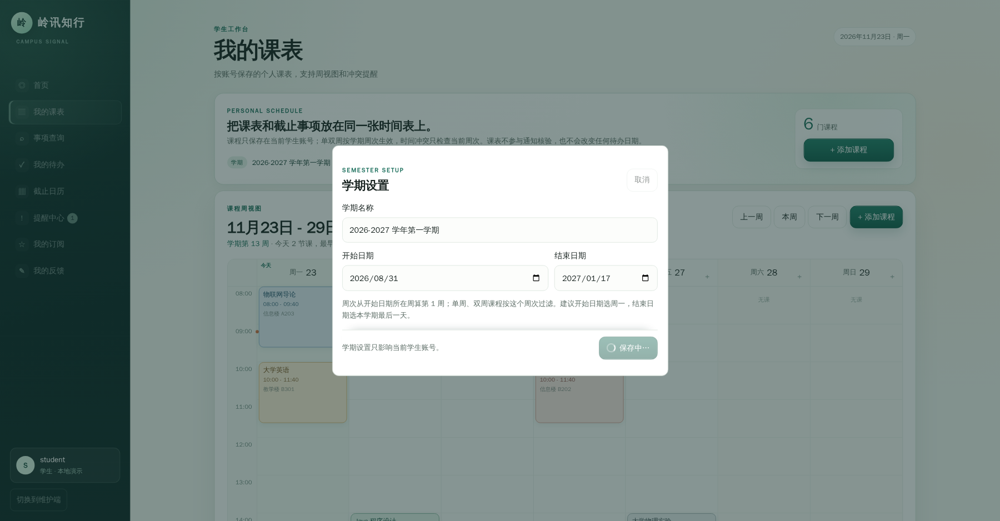

# UI 与按钮体验：20 个 GitHub 参考项目

- 调研日期：2026-11-23
- 适用范围：岭讯知行学生端与管理端的通用交互层，重点是按钮层级、状态、触控、弹窗和反馈
- 结论先行：本轮不是换配色，而是建立一套可复用的按钮状态机。主按钮、次按钮、文字按钮、图标按钮在 hover、active、focus-visible、disabled、loading 下都有明确反馈；弹窗把保存操作固定在底部，避免长表单滚到底才能提交。

## 一、参考项目与借鉴点

### A. 课程表与校园任务项目（12 个）

| # | 项目 | 观察到的做法 | 本项目如何借鉴 |
|---|---|---|---|
| 1 | [layzer/ManualSchoolTimetable](https://github.com/layzer/ManualSchoolTimetable) | 以周网格为主体，课程块直接承载时间、地点和颜色 | 保留 7 列周视图；课程块增加 hover 与 active 按压反馈，点击即可编辑 |
| 2 | [elliott-json-park/obsidian-class-timetable](https://github.com/elliott-json-park/obsidian-class-timetable) | 学期配置与单双周规则分离，周次决定显示内容 | 学期起止独立成弹窗；当前周次只显示匹配单双周的课程 |
| 3 | [WyLAskTg/ClassPilot](https://github.com/WyLAskTg/ClassPilot) | 课表、任务、截止日期放在同一工作台 | 首页保留“今天上什么”和“今天要交什么”并排，课表不参与通知核验 |
| 4 | [Whippap/soaring-schedule-remake](https://github.com/Whippap/soaring-schedule-remake) | 移动端优先，周切换和添加入口保持单手可达 | 工具栏“上一周/本周/下一周”在窄屏均分宽度；主按钮在 860px 以下提升到 44px 高 |
| 5 | [lorien123/harmonyos-class-schedule](https://github.com/lorien123/harmonyos-class-schedule) | 信息密度高但触控区域明确，编辑入口不依赖右键 | 课程块点击、日期列“+”按钮都带 aria-label；小图标按钮扩大点击区 |
| 6 | [AmanVerma1067/StudySync](https://github.com/AmanVerma1067/StudySync) | 空状态与首次使用引导清晰 | 周视图保留“无课”占位，避免空白格让人误以为加载失败 |
| 7 | [huishingcheung/Keshu](https://github.com/huishingcheung/Keshu) | 课程颜色成组管理，冲突课程需要明显区分 | 六色课程色板；冲突块改用警示边框与并排布局，而不是互相遮挡 |
| 8 | [dibakarsutradhar/schedula](https://github.com/dibakarsutradhar/schedula) | 配色克制，当前周与普通周有层级差异 | 主色保持深绿，当前周只用浅底和细边框强调，不额外加高饱和色块 |
| 9 | [bhuvanesh-sudo/timetable-scheduler](https://github.com/bhuvanesh-sudo/timetable-scheduler) | 冲突检测先于展示，冲突结果有单独提示 | 后端按当前周次实际课程检测冲突；前端并排渲染冲突块 |
| 10 | [kdhoon723/PL-timeTabler](https://github.com/kdhoon723/PL-timeTabler) | 时间轴刻度固定，课程块按起止时间定位 | 08:00–20:00、每小时 72px 的固定时间轴；课程高度由时长计算 |
| 11 | [Pragament/html_timetable_editor](https://github.com/Pragament/html_timetable_editor) | 编辑表单与预览分离，保存后立即回到课表 | 课程弹窗只负责编辑；保存成功后关闭弹窗并在页面顶部给出可关闭提示 |
| 12 | [BrockTimetable/BrockVisualTimetable](https://github.com/BrockTimetable/BrockVisualTimetable) | 强调可读性、对比度和打印/导出场景 | 课程块文字使用深色墨色；保留 `@media print` 和导出日历入口，不为动效牺牲可读性 |

### B. 设计系统与组件库（8 个）

| # | 项目 | 观察到的做法 | 本项目如何借鉴 |
|---|---|---|---|
| 13 | [shadcn-ui/ui](https://github.com/shadcn-ui/ui) | 按钮变体（default/secondary/ghost/destructive）语义清晰，焦点环统一 | 收敛为 `.primary`、`.outline`、`.text-button`、`.warn-text` 四类；焦点环统一为 2px 主色 + 5px 外圈 |
| 14 | [radix-ui/primitives](https://github.com/radix-ui/primitives) | Dialog 负责焦点管理和键盘可关闭，标题与描述有明确关联 | 课程/学期弹窗补 `aria-labelledby`；保留 Esc 关闭和原生焦点回归 |
| 15 | [primer/css](https://github.com/primer/css) | 危险操作、禁用态、加载态边界清楚，不允许用颜色单独表达状态 | 删除课程单独使用警示文字；禁用按钮加 `cursor:not-allowed` 并降低饱和度；loading 同时有文字与 spinner |
| 16 | [mui/material-ui](https://github.com/mui/material-ui) | state layer：hover、pressed、focus 的明度变化分层 | 主按钮 hover 上浮 1px，active 回落并缩小；文字按钮 hover 出现浅底，不改变字号 |
| 17 | [tailwindlabs/tailwindcss](https://github.com/tailwindlabs/tailwindcss) | token 化间距、圆角和触控尺寸，响应式断点明确 | 新增 `--focus`、`--button-radius`；桌面 2.55rem、移动端 2.75rem 的最小高度 |
| 18 | [saadeghi/daisyui](https://github.com/saadeghi/daisyui) | `loading` 状态与按钮内容同层展示，避免按钮宽度跳动 | `aria-busy=true` 时用 `::before` 生成 spinner，文案改为“保存中…/删除中…”，按钮尺寸保持稳定 |
| 19 | [IBM/carbon-design-system](https://github.com/IBM/carbon-design-system) | 键盘焦点必须可见，动效需要尊重 reduced motion | 全站 `:focus-visible` 统一；`prefers-reduced-motion` 下关闭过渡并放慢 spinner |
| 20 | [twbs/bootstrap](https://github.com/twbs/bootstrap) | 按钮层级、disabled、loading 的约定易于理解 | 保留“一个主操作 + 若干次操作”的页面结构；同一屏不出现两个同权重主按钮 |

## 二、已落地的交互规则

### 按钮层级

- 主按钮：每个表单/空状态只保留一个，承担“登录、搜索、保存、提交、保存并核验”。
- 次按钮：取消、上一周、下一周、筛选等，使用透明或浅底描边。
- 文字按钮：导航型动作，如“修改学期”“定位依据”“删除课程”，不抢主按钮视觉。
- 危险动作：删除课程使用 `warn-text`，并在确认后才发请求。

### 状态

| 状态 | 视觉 | 语义/行为 |
|---|---|---|
| hover | 主按钮上浮 1px、阴影加深；次按钮边框转主色 | 只用于可点击状态 |
| active | 按压缩小、阴影收回 | 给触控与鼠标一致的下压反馈 |
| focus-visible | 2px 主色 outline + 5px 浅色外圈 | 键盘 Tab 可见，鼠标点击不常驻焦点环 |
| disabled | 透明度 48%、去饱和、无阴影、`cursor:not-allowed` | 阻止重复提交，同时明确“现在不能点” |
| loading | spinner + “保存中…/删除中…” + `aria-busy=true` | 按 `busyAction` 只标记当前动作，不误伤同屏其他按钮 |

### 反馈与弹窗

- 顶部状态条区分成功与错误：成功带对勾，错误带感叹号，均可手动关闭。
- 状态条使用 `aria-live=polite`、`aria-atomic=true`；错误条目仍保留 `role=alert`。
- 课程和学期弹窗限制在视口高度内滚动；底部操作栏 sticky，保存按钮始终可见。
- 课程颜色从三列网格中独立成整行，消除 6 个色板的横向溢出。
- 弹窗保留原生 `<dialog>` 的 Esc 关闭与焦点回归，不额外拦截键盘。

## 三、验证记录

| 截图 | 说明 |
|---|---|
|  | 成功提示、按钮层级与课表布局 |
|  | 无横向滚动，底部保存栏固定可见 |
|  | 保存中的 spinner、禁用态与“保存中…”文案 |

- `pnpm build` 通过，产物 `index-i0OcsxGP.css`、`index-X5GHJewp.js`。
- 桌面 1920×993 下检查首页、课表、课程弹窗、学期弹窗：无横向滚动条，保存栏可见。
- 成功保存学期后顶部出现绿色提示条，关闭按钮可清除提示。
- 无效学期结束日期被原生日期约束拦下，未发出错误请求。
- 待补：真实窄屏设备截图；当前浏览器 CDP 设备指标覆盖不可用，响应式规则已写入但未在真实 390px 视口复核。

## 四、明确没有照搬的部分

- 没有引入完整组件库或设计 token 体系，避免为一个校园项目增加构建复杂度。
- 没有做课程拖拽改时间：当前编辑以表单为准，拖拽容易误操作，且移动端体验不稳定。
- 没有做自动消失的成功 toast：通知类页面需要可回看，保留手动关闭更稳妥。
- 没有为了动效牺牲对比度：课程块、状态条、按钮文字均保持可读的深色墨色。
